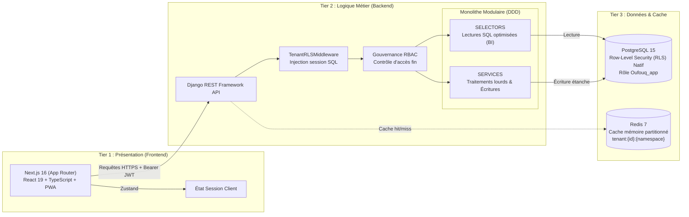

# 🎓 Oufouq — Plateforme ERP SaaS Scolaire Multi-Tenant

[](https://nextjs.org/)
[](https://www.typescriptlang.org/)
[](https://www.django-rest-framework.org/)
[-336791?logo=postgresql)](https://www.postgresql.org/)
[](https://redis.io/)
[](https://www.docker.com/)
[-brightgreen)](#-qualité-logicielle--tests)
[](#-gouvernance-sécurité--conformité)

> **Oufouq** est un Progiciel de Gestion Intégré (**ERP**) distribué en mode **SaaS B2B Multi-Tenant**. Il digitalise l'intégralité du cycle de vie d'un établissement scolaire (de la maternelle au lycée) en décloisonnant la direction, les enseignants, les parents, les élèves et les services logistiques (transport et restauration).

---

## 📌 Table des Matières

- [Aperçu & Proposition de Valeur](#-aperçu--proposition-de-valeur)
- [Architecture du Système](#-architecture-du-système)
- [Gouvernance, Sécurité & Conformité](#-gouvernance-sécurité--conformité)
- [Périmètre Fonctionnel (16 Modules)](#-périmètre-fonctionnel-16-modules)
- [Stack Technologique](#-stack-technologique)
- [Qualité Logicielle & Tests (359 Tests)](#-qualité-logicielle--tests)
- [Installation & Démarrage Rapide](#-installation--démarrage-rapide)
- [Variables d'Environnement](#-variables-denvironnement)
- [Auteurs & Contexte](#-auteurs--contexte)
- [Licence](#-licence)

---

## 🌟 Aperçu & Proposition de Valeur

Le secteur éducatif souffre historiquement d'une **fragmentation des outils** (tableurs Excel isolés, registres papier, messageries informelles), d'une **lourdeur administrative** récurrente et d'un **angle mort décisionnel** pour les directions.

**Oufouq résout ces dysfonctionnements à travers :**
- **Unicité des données :** Une seule source de vérité pour la scolarité, la facturation, l'assiduité et la logistique.
- **Accès Multi-Profils (6 Espaces) :** Direction, Enseignants, Parents, Élèves, Chauffeurs de bus et Surveillants cantine.
- **Modèle SaaS B2B étanche :** Capacité d'héberger des dizaines d'écoles clientes sur une même infrastructure sans compromis sur la confidentialité.
- **Expérience Mobile-Ready :** PWA (Progressive Web App) installable sans store d'applications pour le personnel terrain.

---

## 🏗️ Architecture du Système

Oufouq repose sur une **Architecture 3-Tiers Découplée (API-First)**. Le backend est structuré sous la forme d'un **Monolithe Modulaire** guidé par les principes du **Domain-Driven Design (DDD)**.



### Principes Clés d'Architecture :
1. **Découplage API-First :** Le Frontend (Next.js) et le Backend (Django) communiquent exclusivement par API REST documentée (OpenAPI / Swagger via `drf-spectacular`).
2. **Pattern Service Layer & Selectors :**
   - **Selectors** (ex: `FinanceReportingSelector`) : Requêtes ORM et agrégations en lecture seule pour les tableaux de bord décisionnels.
   - **Services** (ex: `PdfExportService`, `DossierInscriptionService`) : Encapsulation de la logique métier lourde et des écritures transactionnelles.
3. **Partitionnement du Cache :** Clés Redis isolées par tenant (`tenant:<tenant_id>:<namespace>:<params>`) avec invalidation ciblée par événement.

---

## 🛡️ Gouvernance, Sécurité & Conformité

En tant que projet conçu dans les règles de l'art de la **Gouvernance des SI**, Oufouq intègre la sécurité et la conformité dès sa phase de conception (**Security & Privacy by Design**).

### 1. Isolation Multi-Tenant par Défense en Profondeur (RLS)
Pour éliminer tout risque de fuite de données inter-écoles sur une base mutualisée, l'isolation ne repose pas uniquement sur du code applicatif :
- **PostgreSQL Row-Level Security (RLS) Natif :** `FORCE ROW LEVEL SECURITY` activé sur l'ensemble des tables métier.
- **Politique SQL stricte :** 
  ```sql
  CREATE POLICY tenant_isolation_policy ON table_name
  FOR ALL
  USING (
      current_setting('app.current_tenant_id', true) IS NULL 
      OR current_setting('app.current_tenant_id', true) = '' 
      OR current_setting('app.current_tenant_id', true) = 'BYPASS' 
      OR id_tenant_id::text = current_setting('app.current_tenant_id', true)
  );
  ```
- **Rôle Applicatif Non-Privilégié :** L'application s'exécute sous le rôle PostgreSQL `Oufouq_app` (`NOSUPERUSER`, `NOBYPASSRLS`), rendant le contournement physique du RLS impossible.
- **Middleware Dynamique :** `TenantRLSMiddleware` extrait l'identifiant de l'école du token JWT et l'injecte dans la session SQL via `set_config('app.current_tenant_id', ...)` à chaque requête HTTP, puis réinitialise la connexion.

### 2. Matrice d'Habilitations (RBAC) & Moindre Privilège
- Définition stricte des rôles : `DIRECTEUR`, `PROFESSEUR`, `PARENT`, `ELEVE`, `CHAUFFEUR`, `SURVEILLANT_CANTINE`, `SUPER_ADMIN`.
- Permissions DRF granulaires au niveau objet (`IsTenantMember`, `PeutGererAbsences`, `EstProfesseur`).
- Séparation des tâches : Les chauffeurs et le personnel de cantine n'ont aucun accès aux dossiers financiers ni aux notes.

### 3. Conformité CNDP / RGPD & Auditabilité
- **Minimisation des données :** Seules les informations strictement nécessaires à la scolarité et à la sécurité des mineurs sont collectées.
- **Traçabilité des écritures :** Chaque table sensible consigne l'auteur et la date des modifications (`cree_le`, `cree_par`, `modifie_le`, `modifie_par`).
- **Soft Delete (Archivage Légal) :** Aucune donnée financière ou académique n'est supprimée physiquement (`deleted_at`), assurant l'intégrité de l'historique scolaire.

---

## 📦 Périmètre Fonctionnel (16 Modules)

L'ERP s'articule autour de **5 grands pôles métiers** :

| Pôle | Modules Inclus | Fonctionnalités Clés |
| :--- | :--- | :--- |
| **1. Pilotage & Décisionnel** | • Tableau de bord général<br>• Reporting & Analytics (BI) | KPIs consolidés en temps réel, taux de recouvrement, alertes d'assiduité, exports PDF/Excel. |
| **2. Pôle Académique** | • Structure scolaire<br>• Dossier Unique Élève<br>• Emploi du temps<br>• Assiduité<br>• Évaluations & Bulletins<br>• E-Learning | Gestion des cycles/classes/matières, contrôle de conflits de salles/profs, appel numérique en 1 clic, calcul automatisé des moyennes et bulletins officiels PDF, partage de cours et devoirs. |
| **3. Pôle Administration & RH** | • CRM Admissions<br>• Guichet des Demandes<br>• Personnel & RH | Tunnel d'inscription des prospects, traitement des demandes de certificats/attestations en ligne, gestion du personnel. |
| **4. Pôle Finances** | • Facturation & Recouvrement | Échéanciers personnalisés, génération automatique des factures récurrentes, règlements partiels et suivi des impayés. |
| **5. Logistique & Digital** | • Transport Scolaire<br>• Cantine & Restauration<br>• Communication<br>• Vitrine Web (CMS) | Gestion des navettes, circuits et arrêts avec pointage mobile à bord ; gestion des repas et régimes ; messagerie interne sécurisée ; générateur de landing page publique pour chaque école. |

---

## 💻 Stack Technologique

### Frontend
- **Framework :** [Next.js 16](https://nextjs.org/) (App Router, Server & Client Components) + [React 19](https://react.dev/)
- **Langage :** [TypeScript](https://www.typescriptlang.org/) (Typage statique strict)
- **Styling & UI :** [Tailwind CSS 4](https://tailwindcss.com/) + [Framer Motion](https://www.framer.com/motion/) (Animations)
- **State Management :** [Zustand 5](https://github.com/pmndrs/zustand)
- **Data Visualization :** [Recharts 3](https://recharts.org/)
- **Mobile :** PWA via `@ducanh2912/next-pwa`
- **Icônes :** Lucide React

### Backend
- **Framework :** [Python 3.13](https://www.python.org/) + [Django](https://www.djangoproject.com/) + [Django REST Framework (DRF)](https://www.django-rest-framework.org/)
- **Authentification :** JWT Stateless via `djangorestframework-simplejwt`
- **Documentation API :** OpenAPI 3 / Swagger via `drf-spectacular`
- **Tâches asynchrones :** Celery + `django-celery-beat`

### Base de Données & Cache
- **SGBD :** [PostgreSQL 15](https://www.postgresql.org/) avec Row-Level Security (RLS) natif
- **Cache & Message Broker :** [Redis 7](https://redis.io/) via `django-redis`

### DevOps, Qualité & Outils
- **Conteneurisation :** Docker & Docker Compose
- **Tests :** Pytest, Pytest-Django, Playwright E2E
- **Analyse Statique & Linters :** Ruff (Python), ESLint (TypeScript/React), SonarQube
- **CI/CD :** GitLab CI (`.gitlab-ci.yml`) & GitHub Actions (`.github/workflows/ci.yml`)

---

## 🧪 Qualité Logicielle & Tests

Le projet intègre une démarche de test rigoureuse pour garantir la haute disponibilité et le zéro régression en production :

```text
============================= Synthèse des Tests =============================
Backend Unit & Integration Tests (Pytest)     : 347 tests passés
Frontend End-to-End Scenarios (Playwright)    :  12 scénarios passés
-----------------------------------------------------------------------------
TOTAL DES TESTS AUTOMATISÉS                   : 359 tests (100% succès)
Taux de Couverture de Code Globale (Coverage) : 71 % (> 90 % sur le cœur métier)
=============================================================================
```

- **Tests E2E Playwright couvrant :**
  - `parcours-directeur.spec.ts` : Navigation, configuration et gestion financière.
  - `parcours-professeur.spec.ts` : Saisie des notes et appel en classe.
  - `parcours-parent.spec.ts` : Consultation des bulletins et factures.
  - `parcours-eleve.spec.ts` : Accès aux devoirs et planning.
  - `securite-navigation.spec.ts` : Vérification des redirections et étanchéité des tokens.

---


## 👥 Auteurs & Contexte

Projet réalisé en binôme dans le cadre d'un projet de fin d'année d'ingénierie à l'**ENSIASD (École Nationale Supérieure de l'Intelligence Artificielle et Sciences des Données - Taroudant)** :
- **Chaimaa El Khoudri** — *Lead Gouvernance des SI, Co-conception & Full-Stack Development*
- **MOURADI ABDELMOUGHIT** — *Co-conception & Full-Stack Development*

*Développé initialement pour répondre aux besoins du groupe scolaire pilote **Manahil Al Ilm**, puis généralisé en solution SaaS B2B.*

---

## 📄 Licence

Ce projet est distribué sous licence propriétaire dans le cadre de sa commercialisation SaaS B2B. Tous droits réservés.
